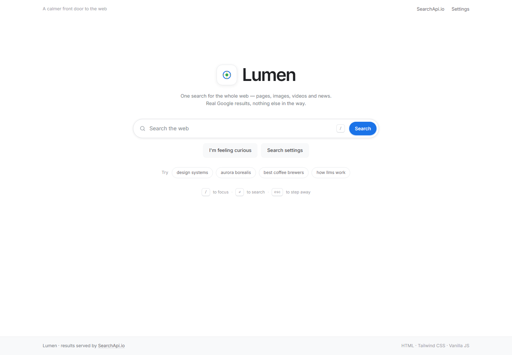
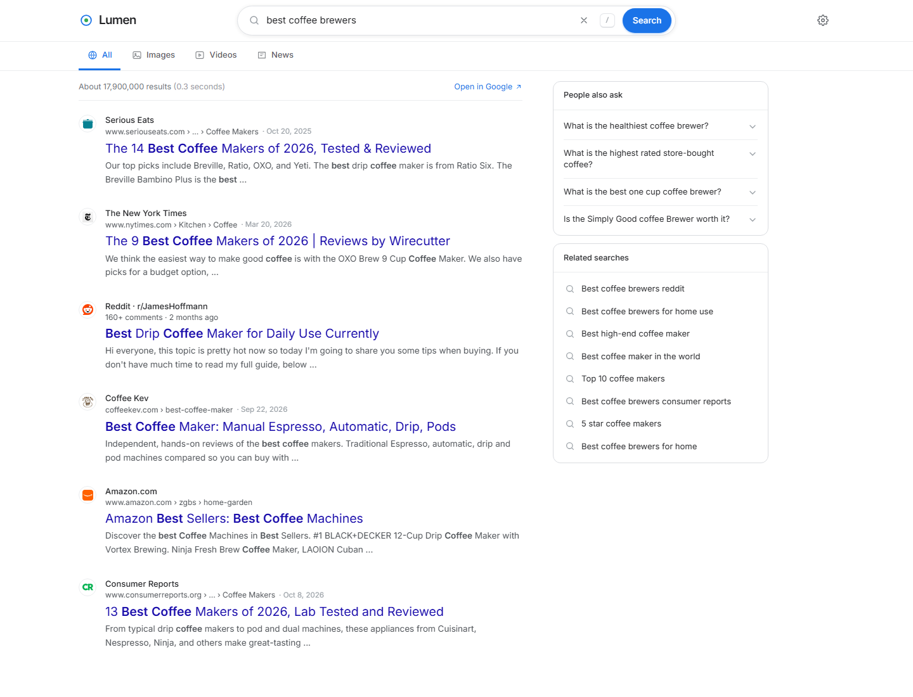

# Lumen

**A calm, fast front door to the web — one HTML file, real Google results.**

Lumen is a premium, single-file search front-end built with HTML, Tailwind CSS and vanilla JavaScript. It talks directly to [SearchApi.io](https://www.searchapi.io/) and renders live Google results for **web pages, images, videos and news** — complete with loading states, error handling, keyboard navigation and deep-linkable searches.

No frameworks. No build step. No backend required.

[](index.html)
[](https://tailwindcss.com/)
[](index.html)
[](https://www.searchapi.io/)
[](LICENSE)



---

## The 3-minute challenge

> **A complete search front-end — custom UI, live Google results, images, videos, news, full keyboard support, loading and error states, documentation and deployment — designed, committed and shipped to GitHub in under three minutes.**
>
> No frameworks. No build step. No compromise on the details.

Lumen was built under that constraint. Everything that makes a search page feel finished is here: a layout that collapses gracefully on every screen, an API layer with abortable requests and caching, safe rendering of untrusted result text, and a light, Google-familiar interface that stays out of the way.

---

## Preview

| Home | Results |
| --- | --- |
|  |  |

---

## Features

- **Live SearchApi.io integration** — real Google results, never mock data.
- **Four result types** — All (organic + featured answer + knowledge panel + People Also Ask), Images, Videos and News.
- **Custom search experience** — Enter-key submit, clear button, recent searches in `localStorage`, suggestion chips.
- **Resilient data layer** — request cancellation with `AbortController`, per-query/tab/language/region cache, retry, and precise error messages for 400 / 401 / 402 / 403 / 429 / 5xx.
- **Polished states** — shimmering skeletons, multicolour progress bar, empty state, inline retry card.
- **Keyboard-first** — `/` or `Ctrl/Cmd + K` to focus, `Enter` to search, `Esc` to leave the field, `↑` / `↓` to walk through result links.
- **Shareable URLs** — `?q=query&tab=images` is written to history; refresh and Back/Forward both restore the view.
- **Responsive** — one-hand mobile layout, sticky command bar on desktop, stacked sidebar on small screens.
- **Safe by default** — every API string is escaped, links and images are protocol-checked (`http`/`https`/`data:image`), and all outbound links use `rel="noopener noreferrer nofollow"`.
- **Accessible** — semantic landmarks, ARIA tabs, live regions, visible focus rings and reduced-motion support.

---

## Tech stack

| Layer | Choice | Why |
| --- | --- | --- |
| Markup | HTML5 | One portable file |
| Styling | Tailwind CSS (Play CDN) + ~200 lines of custom CSS | Fast to iterate, no build pipeline |
| Behaviour | Vanilla JavaScript (ES2020) | No framework, no hydration, instant load |
| Search | SearchApi.io | Real Google SERP data with CORS enabled |
| Type | Inter + JetBrains Mono | Neutral, legible, Google-familiar |

---

## Quick start

```bash
git clone https://github.com/muhammadsami987123/lumen-search.git
cd lumen-search
```

Either open `index.html` directly, or serve it locally (recommended, keeps history and `fetch` behaviour consistent):

```bash
python -m http.server 8791
# http://127.0.0.1:8791
```

> First run: open **Settings** and paste your own [SearchApi.io](https://www.searchapi.io/) key. It is stored in `localStorage` and never leaves the browser.

---

## Configuration

There is exactly **one** place in the client where the key lives — the `CONFIG` block near the top of the script in `index.html`:

```js
const CONFIG = {
  // API KEY — replace this value with your own SearchApi.io key.
  API_KEY: 'YOUR_SEARCHAPI_KEY',

  // Leave empty for direct browser -> SearchApi.io calls.
  // Set to a proxy URL for production.
  PROXY: '',
};
```

You can also set it at runtime without editing code: **Settings → API key**. That value overrides the constant and is kept in `localStorage`.

### `.env`

`.env` is provided for local tooling, scripts and proxy deployments. It is **git-ignored** and must never be committed:

```bash
cp .env.example .env
```

```dotenv
SEARCHAPI_KEY=your_searchapi_key_here
SEARCHAPI_ENDPOINT=https://www.searchapi.io/api/v1/search
SEARCHAPI_ENGINE=google
DEFAULT_LANGUAGE=en
DEFAULT_REGION=us
```

> A static HTML file cannot read `.env` by itself. The browser client uses `CONFIG.API_KEY` (or the value from Settings). `.env` is the source of truth for the proxy/Worker path described below.

### Language and region

Settings exposes both, and they map to SearchApi.io's `hl` and `gl` parameters. Changing either clears the result cache and re-runs the current query.

---

## SearchApi.io integration

Base endpoint: `https://www.searchapi.io/api/v1/search`

| Tab | `engine` | Primary response field |
| --- | --- | --- |
| All | `google` | `organic_results`, `answer_box`, `knowledge_graph`, `related_questions`, `related_searches`, `search_information` |
| Images | `google_images` | `images[]` (thumbnail + original + source) |
| Videos | `google_videos` | `videos[]` (thumbnail, duration, channel, date) |
| News | `google_news` | `organic_results[]` with source, date and thumbnail |

Each tab is requested lazily and independently, then normalised before rendering. The request URL is built in `buildUrl()`:

```js
const params = new URLSearchParams({
  engine: TABS[tab].engine,
  q: query,
  hl: settings.hl,
  gl: settings.gl,
  api_key: getKey(),
});
```

`search_information.total_results` and `time_taken_displayed` drive the "About N results (0.28 seconds)" line — no invented numbers anywhere.

---

## Security & production deployment

SearchApi.io returns `Access-Control-Allow-Origin: *`, so the browser can call it directly. That is perfect for a demo, and it is exactly why a key shipped in client code cannot be secret: anyone can open DevTools and reuse it.

**The simplest secure path** is a 20-line edge proxy. Deploy this to Cloudflare Workers (or Vercel Edge Functions) and store the key as an environment variable:

```js
export default {
  async fetch(req) {
    const url = new URL(req.url);
    const api = new URL('https://www.searchapi.io/api/v1/search');
    api.searchParams.set('engine', url.searchParams.get('engine') || 'google');
    api.searchParams.set('q', url.searchParams.get('q') || '');
    api.searchParams.set('hl', url.searchParams.get('hl') || 'en');
    api.searchParams.set('gl', url.searchParams.get('gl') || 'us');
    api.searchParams.set('num', url.searchParams.get('num') || '10');
    api.searchParams.set('api_key', env.SEARCHAPI_KEY);

    const res = await fetch(api, { headers: { Accept: 'application/json' } });
    return new Response(await res.text(), {
      headers: {
        'content-type': 'application/json',
        'access-control-allow-origin': 'https://your-domain.com',
      },
    });
  },
};
```

Then point the client at it:

```js
const CONFIG = {
  API_KEY: '',
  PROXY: 'https://your-worker.workers.dev/search',
  // ...
};
```

No other code changes are required — `buildUrl()` already prefers `PROXY` when it is set, and the key is never sent to the browser.

---

## Keyboard shortcuts

| Key | Action |
| --- | --- |
| `/` | Focus the search field |
| `Ctrl / Cmd + K` | Focus and select the current query |
| `Enter` | Run the search |
| `Esc` | Blur the field / close settings |
| `↑` `↓` | Move through result links |

---

## Project structure

```
.
├── index.html        # Entire application: markup, styles, logic
├── assets/
│   ├── home.png      # README preview — home
│   └── results.png   # README preview — results
├── .env              # Local key (git-ignored)
├── .env.example      # Template
├── .gitignore
├── LICENSE
└── README.md
```

---

## Notes & limitations

- Google's SERP payload changes over time. Rendering is defensive: missing fields degrade gracefully, unknown sections are ignored.
- Video and news links can be Google redirect URLs (`google.com/goto?url=…`); they resolve normally in the browser.
- Images are capped at 40 per request to keep the DOM light.
- The Play CDN compiles Tailwind in the browser. For a production build, precompile the classes and drop the CDN script.
- Results are fetched from whichever region/language is selected in Settings (`gl` / `hl`).

---

## License

MIT © 2026 [Muhammad Sami](https://github.com/muhammadsami987123)

Search results are provided by [SearchApi.io](https://www.searchapi.io/) and originate from Google. This project is not affiliated with Google.
